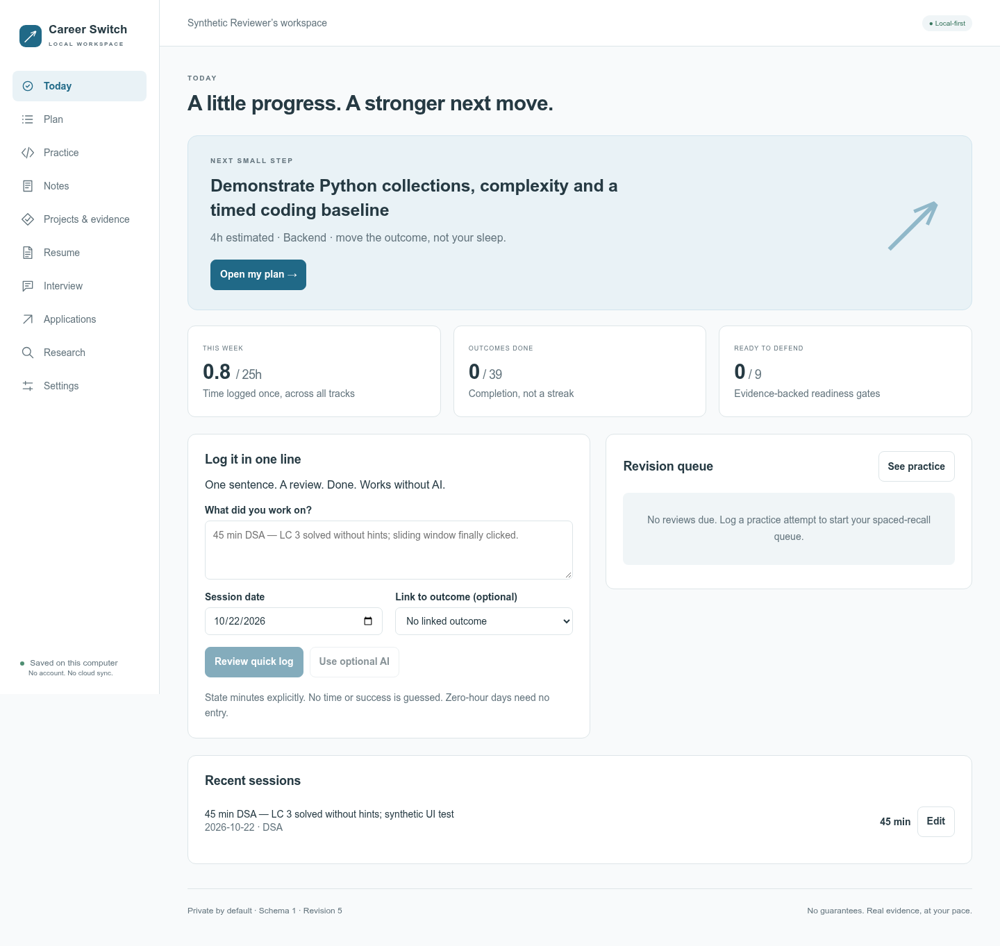

# Career Switch Planner

**Your next career move, at your own pace.** A private-by-default React workspace for learning outcomes, coding practice, notes, project evidence, resumes, interviews and job applications. Runs on your computer. No account, GitHub token, cloud database or subscription required.

> This is a local single-user application, **not** a website to deploy to GitHub Pages or a public Render instance. Keep it on loopback. Career forecasts are estimates—not placement, salary or joining-date guarantees.

## Start in a minute

Install **[Node.js 24 LTS or newer](https://nodejs.org/)** and download/clone this repository:

```sh
git clone https://github.com/OfficialAshish/career-switch-planner.git
cd career-switch-planner
```

- **Windows:** double-click **`start.bat`**. It checks Node, installs locked dependencies when needed, builds the app and opens the browser after the server is ready. Keep the terminal window open.
- **macOS / Linux:** run **`bash start.sh`**, then open **http://127.0.0.1:4317**.
- **Manual:** `npm ci`, `npm run build`, `npm start`.

The **first installation requires internet**. After dependencies are installed, building, tracking, planning, editing, exports and backups work offline. Optional cloud AI and source retrieval need internet. Local Ollama needs its software and model downloaded separately.

All personal data lives in the ignored **`data/`** folder inside your clone. The public repository contains generic templates and a question catalog—**not anyone’s resume or private history**. Stop the server with Ctrl+C before moving the folder.

## Workspace preview



_Illustration uses synthetic test activity. Your own workspace starts with no logged progress._

## What you can do

| Workspace           | Purpose                                                                                                      |
| ------------------- | ------------------------------------------------------------------------------------------------------------ |
| Today               | One-line quick capture, session time, next outcome, revision queue                                           |
| Plan                | Editable competencies, prerequisites and estimates; capacity-limited weekly queue; pace-adjusted forecast    |
| Practice            | 150 categorized DSA + 50 SQL links, difficulty filters, attempts and spaced recall                           |
| Syllabus            | Python, system design, backend and AI concepts; resources, progress, editable AI prompts and Markdown import |
| Notes               | Categories, tags, searchable explanations and local raster screenshots                                       |
| Projects & evidence | Project progress and explicit evidence-backed readiness gates                                                |
| Resume              | Verified-claim editor plus editable LaTeX studio, actual live PDF, clean download and DOCX                   |
| Interview           | Editable truthful stories, follow-ups, five professional unknown-answer styles and mock structure            |
| Applications        | JD, role/location eligibility, stage, notes and next action                                                  |
| Research            | Role/JD-aware search → retrieval → reviewed plan; saved retryable runs and source evidence                   |
| Settings            | Weekly capacity, optional goal/notice, appearance, AI, imports/exports and recovery points                   |

### Dynamic, not deadline-driven

Start at **19 hours/week** or choose your actual capacity. A 3-hour day followed by a 0-hour day is valid. Tasks have editable estimates; completing them and logging linked time updates the forecast. After five completed timed outcomes, the planner uses a bounded median observed pace. Faster progress can bring the estimate forward; blocked work and missing evidence remain visible. An optional goal date never silently cuts the syllabus. There is no automatic resignation recommendation.

### Less data entry

Write: `45 min DSA — LC 3 solved without hints; sliding window clicked.`

The **offline parser** proposes a session and a matching practice attempt. Review the proposed values, then apply. It never invents missing duration or success. Select an outcome if you want that time to inform its estimate. Corrections are editable; manual deletion creates a recovery point and rejects broken references. Quick capture supports one duration total and one question per entry; use separate entries for separate questions.

### Optional AI, under your control

Settings → choose **local Ollama** or an **OpenAI-compatible API**, endpoint and model. For Ollama, a typical endpoint is `http://127.0.0.1:11434`; compatible APIs usually need their documented `/v1` base URL. A model capable of structured JSON is recommended.

AI can propose logs, JD-specific tasks, resume wording, interview drills and summaries of **supplied** research. Every proposal is schema-validated and explicitly reviewed before saving. No model shell commands, arbitrary file tools or silent changes. For bounded online search and planning, use **Research → Research & generate plan**; consent, sources, failures and retries stay visible. Workspace context is **off by default on each request**. Provider keys are memory-only or supplied through your server environment, never returned in the UI or exported. See [AI setup and privacy](docs/AI.md).

### Syllabus beyond DSA, with or without an AI API

Track **33 starter concepts** spanning Python before DSA, SQL/backend, system design and practical AI/LLM/chatbots. Topics include exercises/explanation checks, prerequisites, resource links, progress and evidence. Link them to Plan outcomes so logged time is counted once. Adapt the starter scope to your baseline; it is not an exhaustive readiness guarantee.

**Syllabus → Build fresh context prompt** fills saved role/capacity/outcome context. Edit it, use your configured AI, or copy/download it to another AI and import the response Markdown. All imported syllabus records are validated, previewed and initially unstarted; no API is needed for manual tracking or Markdown import. See [syllabus and prompt workflow](docs/SYLLABUS.md).

### Portable, not locked in

- **Full JSON backup:** workspace + referenced images + LaTeX documents + research runs. Restore shows a replacement preview and keeps the previous revision first.
- **Excel tracker:** Dashboard first, editable profile, all tracking records, syllabus/resources, long LaTeX source and saved prompts. Attached images and research archives travel in a hidden portable sheet. Treat the workbook as personal data, not a sanitized shareable report.
- **Excel reconciliation:** export → edit → import → review → apply. Three-way baseline checks reject conflicting app/Excel edits. Missing rows are preserved; `_delete=YES` explicitly deletes with reference checks. A different-workspace workbook requires full-replacement confirmation. No live sync, provider keys, compiler cache or Excel execution of AI. See [data format and spreadsheet scope](docs/DATA.md).
- **Resume:** import and edit your existing `.tex`, install the optional local compiler, preview the actual PDF as you edit and download it with **no app watermark**. Compact classic and blue templates are included. Structured claim exports remain available. See [LaTeX studio](docs/LATEX.md). Verify all factual claims before sending.

## First 15 minutes

1. Enter your profile, actual weekly capacity, target role and contractual notice in Settings. An ambitious date is optional.
2. Review the generic outcomes. Edit estimates and prerequisites to match your baseline; don’t claim completed work merely to make a forecast earlier.
3. Add existing projects and evidence gaps. Keep employer/client material out.
4. Record one real session and one honest practice result.
5. Add a few resume claims. Mark Verified only when you can defend the exact wording. Future work stays Planned/Working.
6. Export a full backup; keep a copy outside this computer periodically.

## Development

```sh
npm ci
npm run check          # TypeScript, domain/API/export tests, production build
npm run format:check
npx playwright install chromium
npm run test:e2e       # starts an isolated test server with synthetic data
npm run dev            # build frontend once + watch server TS; rebuild for UI edits
```

If a system Chromium is already installed, set `CHROMIUM_PATH` for browser tests. Test screenshots and reports are ignored. CI runs build/tests/browser checks on Linux and Windows; it does **not** deploy anything. Current recorded evidence and limitations: [verification](docs/VERIFICATION.md).

### Configuration

| Variable               | Default | Purpose                                                             |
| ---------------------- | ------- | ------------------------------------------------------------------- |
| `PORT`                 | `4317`  | Local port, 1024–65535; server always binds 127.0.0.1               |
| `CAREER_DATA_DIR`      | `data`  | Explicit private data-folder override                               |
| `OPENAI_API_KEY`       | unset   | Optional compatible-provider credential, read only by server        |
| `BRAVE_SEARCH_API_KEY` | unset   | Optional supported search API; otherwise best-effort keyless search |
| `CAREER_TECTONIC_PATH` | unset   | Optional owner-managed local compiler executable                    |

`.env.example` documents names only; `.env` is **not automatically loaded**. Use your shell’s environment. Never commit real keys. Provider endpoint/model are saved under your private data folder; the key entered in the app is not persisted.

## Documentation

- [Architecture and trust boundaries](docs/ARCHITECTURE.md)
- [User guide and weekly workflow](docs/USER-GUIDE.md)
- [AI setup, research workflows, prompts and data sharing](docs/AI.md)
- [LaTeX source editor, clean PDFs and compiler setup](docs/LATEX.md)
- [Data formats, Excel and backups](docs/DATA.md)
- [Security policy](SECURITY.md) · [Privacy](docs/PRIVACY.md)
- [Recovery and troubleshooting](docs/RECOVERY.md)
- [Verification and honest limitations](docs/VERIFICATION.md)
- [Progress / next step](docs/PROGRESS.md) · [Decisions](docs/DECISIONS.md)
- [Contributing](CONTRIBUTING.md) · [Changelog](CHANGELOG.md) · [Roadmap](docs/ROADMAP.md)

## Scope and limitations

This is a local productivity tool, not a recruiter, unbounded autonomous agent or audited financial/legal adviser. No cloud sync, multi-user accounts, native mobile app, PDF resume ingestion, live salary feed or universal job scraper. Some sources block retrieval; paste an excerpt instead. Workbook exchange is intentionally narrower than a full backup. Data is **not encrypted at rest**; rely on your OS account and disk encryption. Local software with access to your files is outside the server’s isolation boundary.

The catalog links to LeetCode; access and premium requirements can change. Problem titles are navigational references, not copied solutions. All projects and metrics must be your own defensible work.

## License

[MIT](LICENSE). Optional model/provider terms and third-party content licenses still apply. Contributions welcome; use synthetic examples only.
